## 前情提要

本次教程使用LiveContainer+SideStore二合一版本，此版本还处于试验阶段，本人体验没有发现恶性bug，请勿用于重要场景！！！

## 准备工作

- 一台运行Windows 10或更高版本的PC
- 一部运行iOS/iPadOS 14或更高版本的设备
- 一个美区Apple ID（无须充值或绑定信用卡）
- 良好的网络

## 重要提醒

请确保你的PC的用户名为英文，否则可能会出现莫名其妙的问题，如果遇到，推荐更换设备或使用网吧电脑。如果你已经在使用网吧电脑，请确保后续步骤中将手机与电脑的连接线插到机箱后面的主板接口上（家用电脑也是一样）！！！

## 所需文件

在电脑上下载以下文件：

- [AltServer 安装包](https://cdn.altstore.io/file/altstore/altinstaller.zip)
- [AltServer 支持 iCloud](https://updates.cdn-apple.com/2020/windows/001-39935-20200911-1A70AA56-F448-11EA-8CC0-99D41950005E/iCloudSetup.exe)
- [idevice pair](https://github.com/jkcoxson/idevice_pair/releases/download/v0.1.3p1/idevice_pair--windows-x86_64.exe)
- [LocalSend](https://localsend.org/zh-CN/download)
- [SideStore IPA 安装包](https://github.com/sidestore/sidestore/releases/latest/download/sidestore.ipa)
- [LiveContainer+SideStore二合一安装包](https://github.com/LiveContainer/LiveContainer/releases/latest/download/LiveContainer+SideStore.ipa)

## 安装步骤

可以配合视频食用😋：https://www.bilibili.com/video/BV11kYYzBEBT/

### 安装 AltServer

记得先安装[AltServer 支持 iCloud](https://updates.cdn-apple.com/2020/windows/001-39935-20200911-1A70AA56-F448-11EA-8CC0-99D41950005E/iCloudSetup.exe)，这俩都没啥讲究，一路下一步就行。

> 需要注意的是如果你已安装 Microsoft Store 版本的 iCould/iTunes，请卸载它。

### 使用 AltServer 安装 SideStore

1. 用数据线连接设备
2. 运行AltServer
3. 去资源管理器托盘栏找到一个棱形图标,Shift + 左键
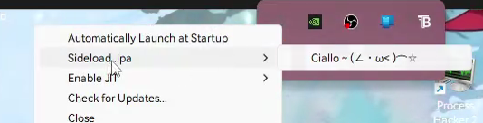
4. 鼠标移动到**Sideload .ipa**点击你的设备名，选择上面下载的**SideStore IPA**
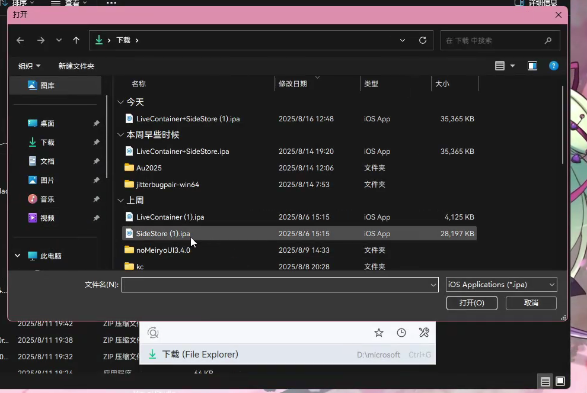
5. 这时候会弹出窗口要你输入你的 Apple ID 和密码，放心输入，完了验证一下，稍等片刻你的手机桌面上就有 SideStore app 了（这时候先不要打开它）
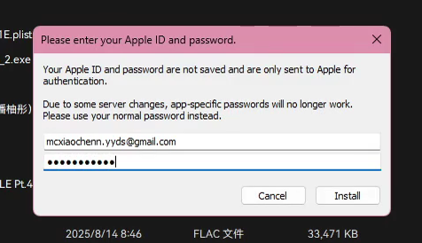

### 使用idevice pair获取设备文件

1. 打开上面下载的[idevice pair](https://github.com/jkcoxson/idevice_pair/releases/latest/download/iDevicePair--windows-x86_64.exe)程序
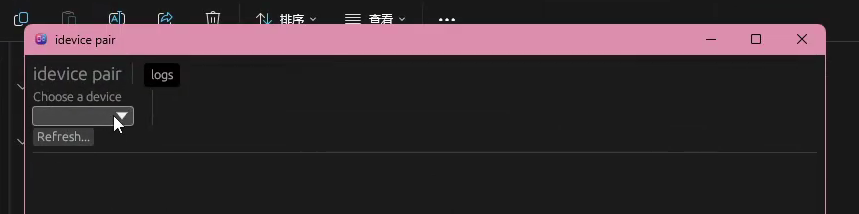
2. 不要着急不要慌\~，确定你的手机已连接电脑并解锁，点击**Refresh**然后打开上方复选框选中你的设备名
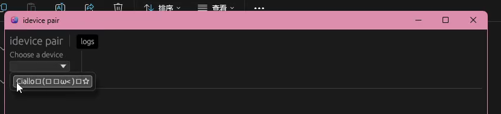
3. 确定开发者选项已开启，点击**Generate**生成配置文件
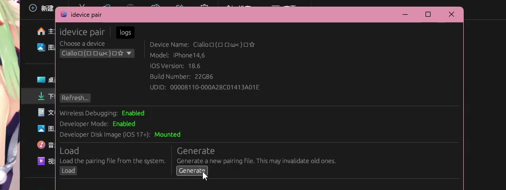
4. 往下翻一点找到**SideStore**项，点击**Install**
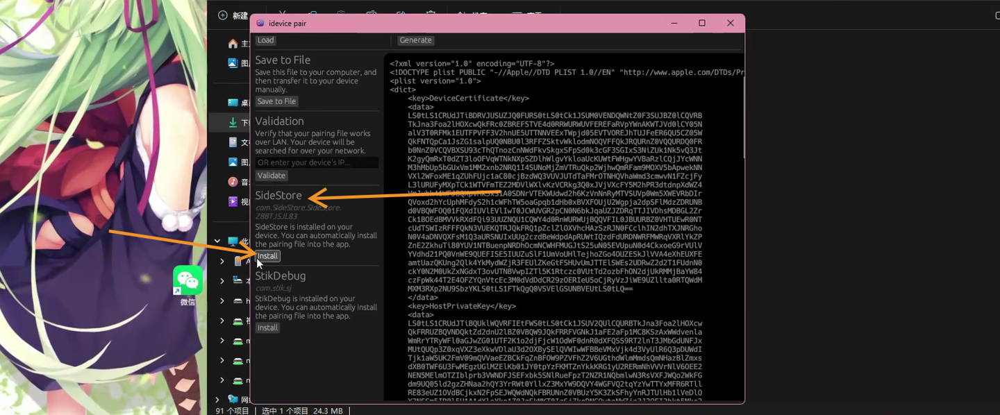
5. 保存配置文件到本地，点击**Save to File**项中的**Save to File**，把它保存到一个你能记住的地方
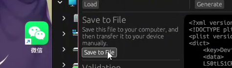

### 传输必要文件到手机上

1. 把上方 **使用idevice pair获取设备文件**步骤 中保存的``xxxxx-xxxxx-xxxxx-xxxxx.plist``文件和刚刚下载的[LiveContainer+SideStore二合一安装包](https://github.com/LiveContainer/LiveContainer/releases/latest/download/LiveContainer+SideStore.ipa)，使用[LocalSend](https://localsend.org/zh-CN/download)传输到手机上
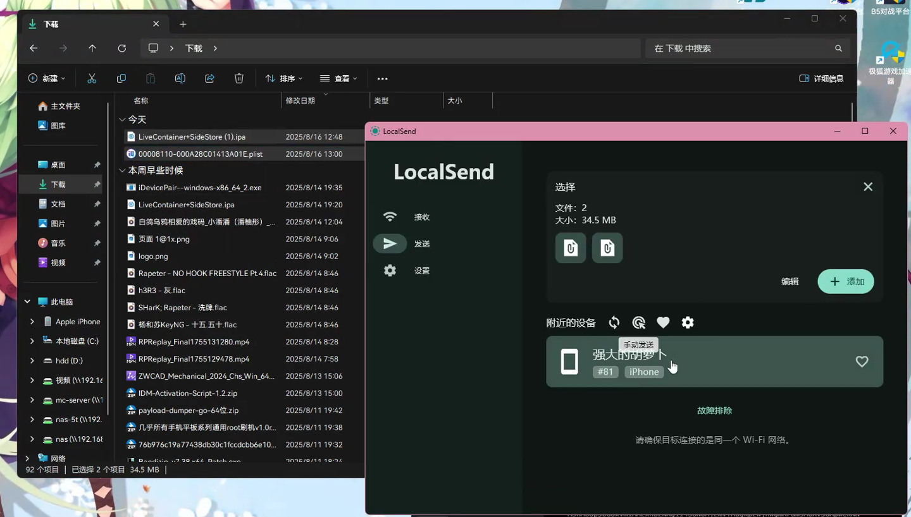

### 安装与启用 StosVPN

1. AppStore登录你的美区Apple ID
2. 搜索并下载StosVPN（**后续都需要，不要卸载，在每次使用SideStore的时候都需要开启**）
> StosVPN 不连接外网，仅用于本机通信以支持SideStore
3. 连接StosVPN

### 配置SideStore

1. 打开SideStore，在设置页面使用安装时的Apple ID登录
2. 点击+号 -> 选择**LiveContainer+SideStore二合一安装包** -> ``Yes`` -> ``Got it`` -> ``Refresh Now`` -> ``Keep App Extensions（Use Main Profile）`` -> 好辣！
3. 运行**LiveContainer**确定可以正常打开
4. 卸载SideStore

### 配置LiveContainer内的SideStore

1. 点击LiveContainer软件内上方菜单栏中的SideStore图标
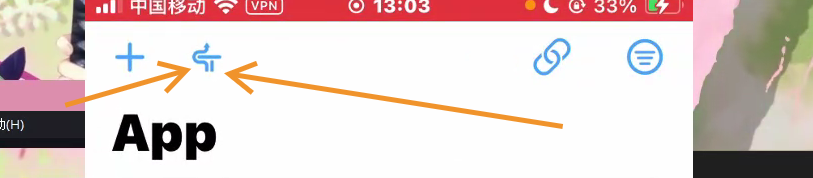
2. 此时软件会闪退，再进去你会发现已经变成SideStore的界面了
3. 图里这一步点``OK``导入之前设置的配置文件（如果这一步点错了可以去**常见问题查看解决方法**）
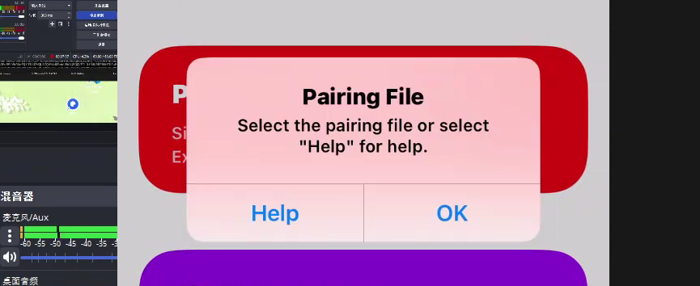
4. 进入``app``页，点击``Refresh Now``，登录**配置SideStore**时使用的Apple ID
5. 重复 ``Yes`` -> ``Got it`` -> ``Keep App Extensions（Use Main Profile）`` -> 好辣！
6. 退出后台再进，回到LiveContainer界面，点击``设置``，``刷新来自SideStore的证书``，按照引导导入

### 续签相关



快捷指令：

### 大功告成

完成后你就可以愉快使用此工具了 :)

下期教程教如何在此基础上启动JIT，敬请期待

## 常见问题

### 安装iCloud提示电脑缺少媒体功能

Windows Media Player 可在 PC 上播放视频和音频文件。你需要有 Media Player 才能安装 Windows 版 iCloud。如果你在尝试下载 Windows 版 iCloud 11 或更高版本时收到一条信息，提示你需要安装媒体功能包才能使用 iCloud，请选择“下载”。然后，按照下一屏幕上的说明进行操作。

如果你关闭了 Windows 媒体功能，或者如果你的 PC 未安装 Windows Media Player，则无法安装 Windows 版 iCloud。

1. 前往“控制面板”>“所有控制面板项”>“程序和功能”。
2. 点按“启用或关闭 Windows 功能”。
3. 选中媒体功能对应的框，以重新打开该功能。
4. 点按“好”。

如果你看到一条信息，提示你重新启动 PC，请重新启动电脑，然后安装 Windows 版 iCloud。

### 我选错了/没选Pairing File

可以在SideStore点``Settings``->``Reset Pairing File``然后大退app重选

### SideStore报错xxxxx

去[SideStore官方文档](https://docs.sidestore.io/docs/troubleshooting/error-codes)查看对应报错代码，看不懂用翻译，还是不懂把报错丢给AI，实在解决不了再问我。

---
## 参考资料（排名不分前后）
- https://docs.sidestore.io/zh/docs/intro
- https://sidestore.io/#get-started
- https://livecontainer.github.io/zh-CN/docs/intro
- https://github.com/LiveContainer/LiveContainer
- https://zhuanlan.zhihu.com/p/1906028906898786136
- https://www.bilibili.com/opus/978121704634056721
- https://support.apple.com/zh-cn/102361